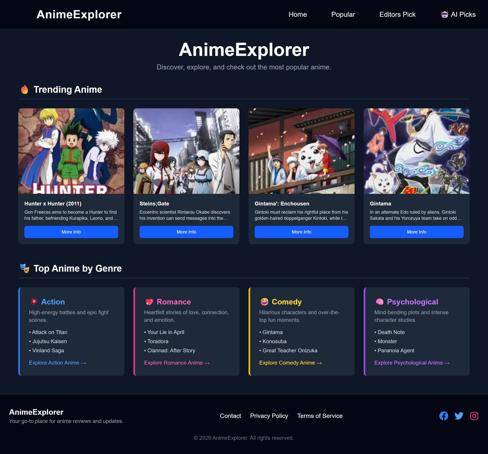

# 🌟 AnimeExplorer

A modern, accessible web app for discovering anime, built with **Next.js**, **TypeScript** and **Tailwind CSS**. Browse trending and popular anime, or let AI pick your next watch. 🎌📺

[🔗 View the Website](https://anime-search-explore.vercel.app)

## 🎯 Features

- 🔥 **Trending** – Top anime on the home page.
- 🏆 **Popular** – The most popular anime of all time.
- 🎯 **Editor's Picks** – A hand-picked top 12.
- 🤖 **AI Picks** – Name an anime you like, a genre or a mood, and Claude AI recommends anime with covers, scores and direct MyAnimeList links.

## 🛠️ Tech Stack

- **Next.js** (App Router) + **React** + **TypeScript**
- **Tailwind CSS**
- **Jikan API** (unofficial MyAnimeList API) for anime lists
- **Claude API** (Anthropic) for AI recommendations
- **AniList API** for covers and MyAnimeList links in AI Picks
